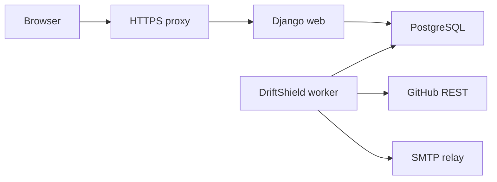

# Architecture

DriftShield is a Django modular monolith. Gunicorn serves the web application and a separate systemd service runs the worker from the same code and schema. PostgreSQL is the production datastore. Browser requests use server-rendered Django templates and local CSS. The product needs one web service, one worker and one database.

| Module | Responsibility |
| --- | --- |
| `driftshield/settings.py` | Environment, TLS assumptions, sessions, database and mail |
| `governance/views.py` | Authentication, scoped routes, validation, HTML, CSV |
| `governance/github.py` | Repository identity, scoped App credentials, pagination, canonical snapshots |
| `governance/domain.py` | Baseline approval, policies, findings, evidence and atomic notification enqueue |
| `governance/worker.py` | Claim and recover work, send alerts, maintenance, weekly summaries |
| `governance/management/commands/` | Provision and revoke access, bind GitHub App, worker CLI |

A worker claims a due monitor with a database row lock and a five-minute lease. Network requests run outside the transaction. Completion checks the lease, then locks workspace and monitor in that order. It persists the scan, adjusts the next due time, evaluates the baseline and policy, and enqueues any notifications in one transaction. If the process stops before committing, another worker can reclaim the job after lease expiry. The same scheme applies to outbox claims. Email is at-least-once because an SMTP server can accept a message before the worker commits its delivery state.

A failed collection preserves the last good observation and open incidents. The worker schedules exponential backoff and respects GitHub retry times. Changes are detected only if visible during collection. A change made and undone between scans can be missed. The dashboard uses the server clock and distinguishes paused, awaiting scan, overdue, unavailable, needs baseline, findings open, and matching baseline.

A successful comparison can resolve a finding. An operator may also approve selected fields with a recorded reason. Approval verifies both the observed revision and current baseline version. A policy finding is independent of baseline approval. Worker timestamps describe when DriftShield observed the state. The GitHub user responsible for a change is outside this product's evidence.

## Infrastructure adapters

The standalone `collector` runs on the customer's network. Each adapter projects provider data into the same bounded snapshot protocol. The `infrastructure` Django module authenticates each target, serializes deliveries, evaluates findings and writes notifications using the same workspace and outbox as GitHub monitoring. A collector only sends outbound observations. It has no inbound command interface.
